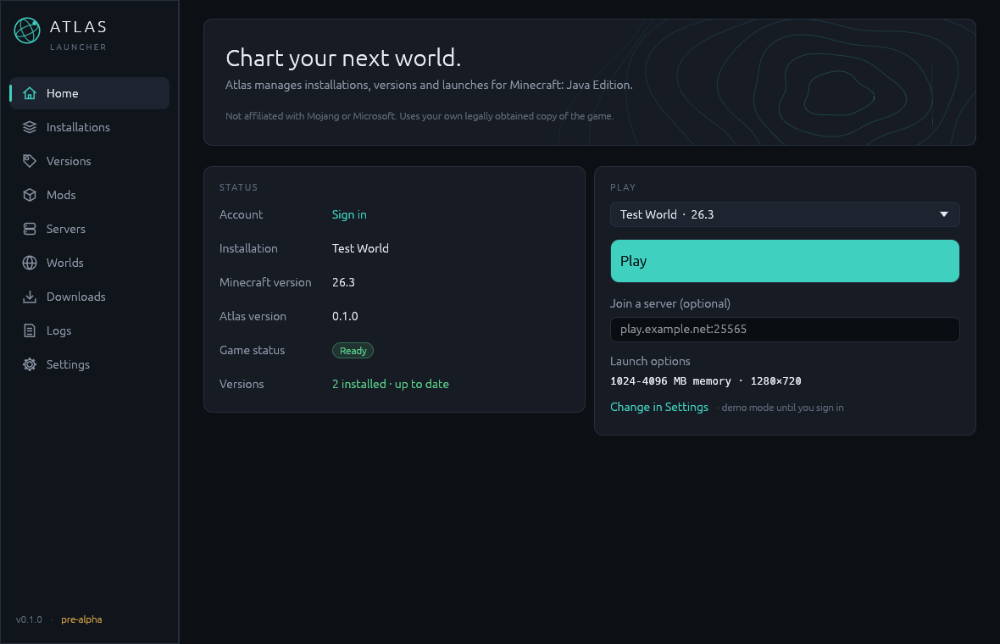

# Atlas Launcher

A launcher for Minecraft: Java Edition, written in Rust. Atlas installs
game versions straight from Mojang, checks every file, keeps each
installation separate, and gets out of your way when you hit Play.



> Pre-alpha. Most things work, some edges are rough. Atlas isn't made by or
> affiliated with Mojang or Microsoft, and it doesn't ship any game files:
> you need your own copy of Minecraft.

## What it does

- **Versions:** every release and snapshot from Mojang's official list.
  Downloads resume if interrupted, every file is checked against Mojang's
  hashes, and Repair re-downloads only what's broken. Files you already
  have in another launcher's folder get reused instead of downloaded again.
- **Installations:** as many as you like, each with its own version, game
  folder, memory and Java settings. Point one at an existing folder and
  Atlas will never delete it.
- **Playing:** Atlas downloads the right Java for each version, starts the
  game, shows its output live, notices crashes and links the crash report.
  You can join a server straight from the launcher.
- **Microsoft sign-in:** in your browser, with a device-code fallback.
  Atlas never sees your password, and tokens stay in your system's
  keychain. Without an account you can still play the demo.
- **Servers:** a saved list that shows who's online.
- **Mods and packs:** list, enable, disable and remove mods (Fabric, Quilt,
  Forge and NeoForge metadata is read), plus resource and shader packs.
  Modrinth `.mrpack` modpacks can be imported. Atlas doesn't install mod
  loaders yet.
- **Worlds:** list, back up to zip, and delete (which always backs up first).
- **Logs:** launcher and game logs with search and filters. Tokens are
  stripped out automatically.
- **CLI:** everything above is also available as `atlas …`, with `--json`
  for scripts.
- **AI assistants (optional):** a local MCP server, off by default.
- **Self-update:** signed releases only, with automatic rollback if a new
  version won't start.

## Build it

You need Rust 1.85 or newer.

```bash
cargo run --release -p atlas-ui --bin atlas-launcher
```

On Linux you may need `libxkbcommon-x11-0` (Debian/Ubuntu) for the window.
Run the tests with:

```bash
cargo test --workspace
```

## Command line

```bash
atlas install latest
atlas instances create Survival --version latest
atlas play
atlas play --server play.example.net
atlas versions --installed
atlas verify 26.3
atlas mods
atlas worlds backup "My World"
atlas servers add Friends mc.example.net
atlas import pack.mrpack
atlas account login
atlas logs --level warn -n 50
```

Anything destructive needs `--yes`. Run `atlas --help` for the full list.

## Using it with an AI assistant

1. Turn on Settings → Advanced → **Enable AI features**, then **Local MCP server**.
2. Press **Copy assistant config** and paste it into your assistant's MCP
   settings, or run `atlas mcp token` to get the config.

The assistant can look things up, install versions and start the game. It
can't see your account, and anything destructive gives it a code that you
have to approve yourself with `atlas mcp approve <code>`. Switching AI off
stops the server immediately.

## Release setup (for maintainers)

- **Microsoft sign-in:** set the repo variable `ATLAS_MS_CLIENT_ID` to your
  Azure app id. That app needs Mojang's approval for the Minecraft API.
- **Signed updates:** run `cargo xtask keygen`. Put the private key in the
  secret `ATLAS_UPDATE_KEY` and the public key in the variable
  `ATLAS_UPDATE_PUBKEY`.
- **Publishing:** push a tag like `v0.2.0` and GitHub Actions builds the
  Windows, macOS and Linux packages.

More detail is in [docs/ATLAS_ARCHITECTURE.md](docs/ATLAS_ARCHITECTURE.md).

## License

MIT, see [LICENSE](LICENSE).
